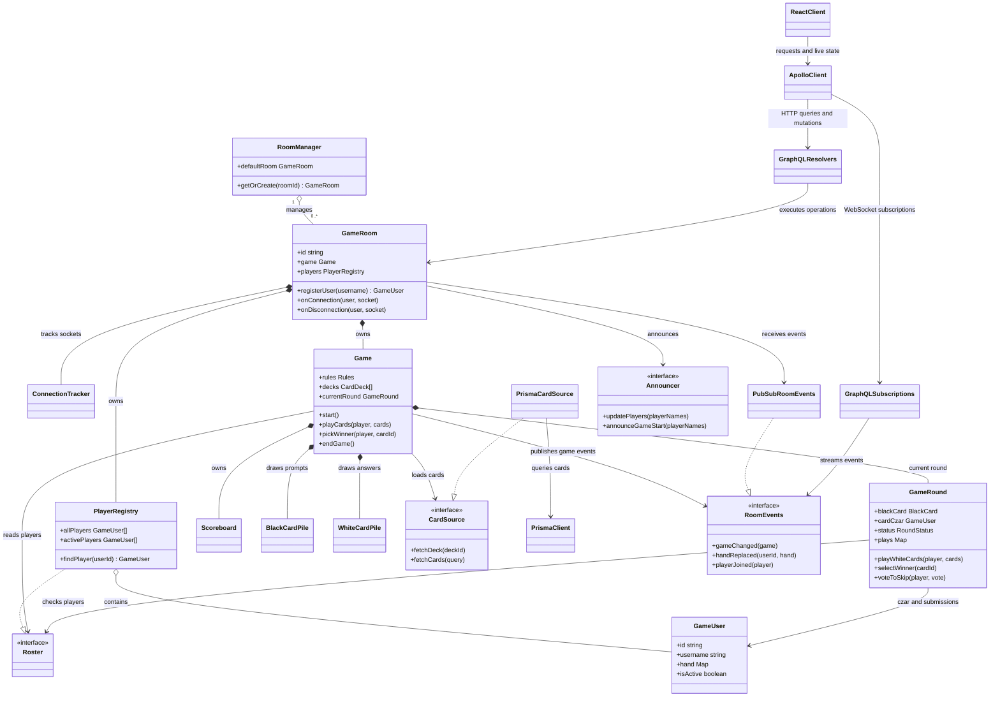
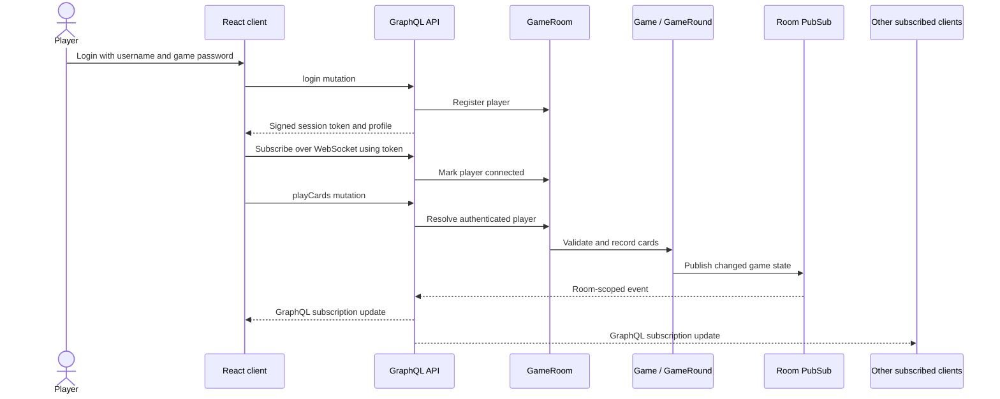

# Architecture

This page describes the current implementation. In particular, the runtime currently routes game requests to a single default room; `RoomManager` can create rooms, but the API does not yet select different rooms.

## UML class diagram

`Roster`, `CardSource`, `RoomEvents`, and `Announcer` are boundaries between game rules and infrastructure. The `Game` can manage rounds and scoring without depending directly on GraphQL, PostgreSQL, sockets, or Discord. The room composes these implementations at startup.

## Interaction flow

The client first loads the game and the current player's hand with GraphQL queries. It then subscribes to room events and private player events. Mutations are authenticated with the signed token; the GraphQL context resolves the player in the default room before calling the game methods. As the game changes, `PubSubRoomEvents` publishes public state to the room and hand/profile changes to a user-specific topic.

## Game lifecycle

1. Players join the room. A game requires at least three active players.
2. A player with access configures decks and rules, then starts the game. `PrismaCardSource` loads the cards for the selected decks; the game creates shuffled card piles, deals hands, and chooses a czar.
3. While a round is waiting, each non-czar submits the number of cards requested by the black card. Submissions remain hidden while players can still undo. Once submissions are complete, the game waits five seconds, shuffles the plays, and reveals them to the czar.
4. The czar picks the winning play. The scoreboard awards a point and, after an eight-second winner display, the game either starts another round or ends when its winning score rules are met.
5. If the czar disconnects, the room allows a five-second reconnect window before skipping the round and selecting another czar. Disconnected players remain in the room for 30 seconds before being removed; reconnecting within that window cancels removal.

## Persistence and services

- **PostgreSQL / Prisma:** stores decks, black and white cards, deck-manager accounts, and deck-manager sessions.
- **In-memory room state:** stores connected game users, hands, current round, card piles, and score. Active game state is not persisted across a server restart.
- **GraphQL HTTP:** handles initial reads and game actions at `/api/graphql`.
- **GraphQL WebSocket:** streams room changes and player-specific updates at `/api/graphql`.
- **Deck-management REST API:** serves `/api/manage` routes for account sign-in and custom deck editing.
- **Optional integrations:** Google OAuth signs in deck-management accounts; a Discord webhook can announce room membership and game starts.
